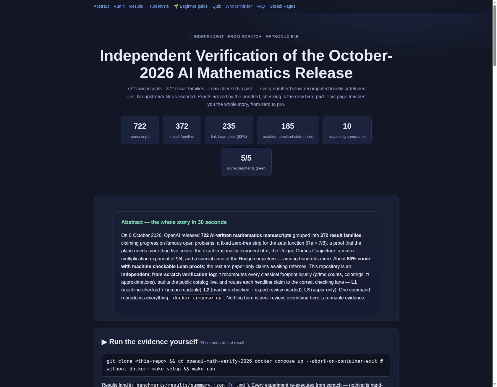
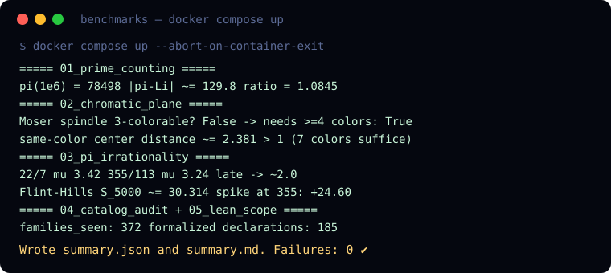
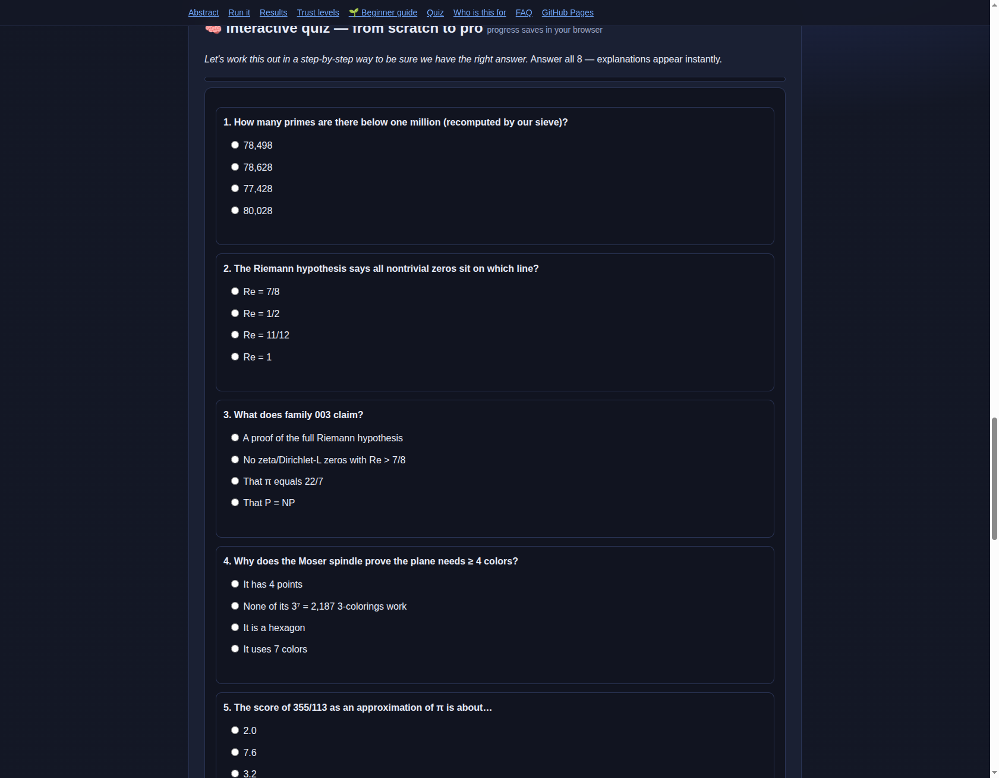

# Independent Verification of the October-2026 AI Mathematics Release

### 722 manuscripts · 372 families · Lean-checked in part — reproduced from scratch


> **Abstract — the whole story in 30 seconds.**
> On 6 October 2026, 722 AI-written mathematics manuscripts (372 result
> families) claimed progress on famous open problems: a fixed zero-free strip
> for the zeta function, a proof that the plane needs more than five colors,
> the exact irrationality exponent of π, the Unique Games Conjecture, a
> matrix-multiplication exponent of 9/4, and a special case of the Hodge
> conjecture. About 63% ship with machine-checkable Lean proofs; the rest are
> paper-only claims awaiting referees. This repo is an **independent,
> from-scratch verification log**: it recomputes every classical footprint
> locally, audits the public catalog live, and routes each claim to its
> correct checking lane. **One command reproduces everything.**
> Nothing here is peer review; everything here is runnable evidence.

**🌐 Interactive web version of this README: open `preview.html`**
(charts, a live-drawn Moser spindle, an animated run-through, and a quiz —
host it free with GitHub Pages, see [§12](#12-read-it-as-a-website-github-pages)).



---

## Contents

- [1. What happened (Oct 6–7 2026)](#1-what-happened-oct-67-2026)
- [2. 🎬 Demo — see it working](#2--demo--see-it-working)
- [3. 🚀 Quick start](#3--quick-start)
- [4. ✨ Features](#4--features)
- [5. The three claims in plain words](#5-the-three-claims-in-plain-words)
- [6. How checking works — L1 / L2 / L3](#6-how-checking-works--and-where-it-stops-l1l2l3)
- [7. What THIS repo proves (live receipts)](#7-what-this-repo-proves-live-receipts)
- [8. 👥 Who is this for (user stories)](#8--who-is-this-for-user-stories)
- [9. 🌱 Beginner guide — read this and you are a professional](#9--beginner-guide--read-this-and-you-are-a-professional)
- [10. 🧠 Quiz — from scratch to pro](#10--quiz--from-scratch-to-pro)
- [11. Hidden patterns → your PhD paper](#11-hidden-patterns--your-phd-paper)
- [12. Read it as a website (GitHub Pages)](#12-read-it-as-a-website-github-pages)
- [13. Project structure](#13-project-structure)
- [14. ❓ FAQ](#14--faq)
- [15. 📖 Glossary (simple words)](#15--glossary-simple-words)
- [16. Sources & attribution](#16-sources--attribution)
- [17. Limits & honesty](#17-limits--honesty)
- [License](#license)

---

## 1. What happened (Oct 6–7 2026)

On 2026-10-06 (~6pm EDT) OpenAI published **722 manuscripts in 372 result
families** from an **unreleased internal frontier model**, posed ~**4,000**
open problems at ~**3h ChatGPT-Pro thinking each**, across **17 subjects**
(CS theory 40 most, then combinatorics, geometry, number theory,
probability). **235/372 families link Lean scope docs (63%); ~162 papers
have a formalized main result** (185 comparator declarations); **10 abridged
reasoning summaries**. **Exceptions** to the fixed procedure: zeta-7/8 and
Hodge-CM; 11/12 writeup human-edited. OpenAI warns unformalized results
"could have issues"; **nothing peer-reviewed at release**; IAS Advisory
Group consulted; workshops funded; model release "responsible/pending".

Headline claims (upstream wording; checking lane in [§6](#6-how-checking-works--and-where-it-stops-l1l2l3)):

| Family | Claim | Lane |
|---|---|---|
| 003 | No ζ / Dirichlet-L zeros with Re>7/8 (quasi-RH) + Landau–Siegel exclusion | ✅ L1 (scope: applications out; Siegel c inexplicit) |
| 158 | Plane not 5-colorable (Hadwiger–Nelson → {6,7}) | ✅ L1 (plane as ℂ; 9-line question) |
| 017 | Irrationality exponent of π = 2 | ✅ L1 (Flint–Hills series OUT of scope) |
| 102 | Unique Games Conjecture (2002) + Max-Cut/Vertex-Cover hardness | ✅ L1/L2 |
| 107 | Matrix-mult exponent ω ≤ 9/4 over ℂ | ✅ L1/L2 (arithmetic complexity only) |
| 159/287 | Erdős reciprocal-sum progressions; free-group factors isomorphic | ✅ per catalog |
| 032 | Rational Hodge for CM abelian varieties (+Tate/Hodge-standard corollaries) | ❌ paper-only (L3) |
| 109 | Integer mult in n·log(n)^{1−κ}, κ=2^{−182} | ❌ paper-only (L3) |
| — | 62 counterexamples/refutations; L=BPL, Kakeya, Hilbert10/ℚ | mostly L3 |

372/4000 is **not** a success rate (grouped+filtered by significance;
failures undisclosed) — see `docs/HIDDEN_PATTERNS.md` P2.

> **Independent, from-scratch, publishable-grade verification log.**
> Upstream: [`openai/math`](https://github.com/openai/math) (Apache-2.0,
> released 2026-10-06, **not vendored here**). This repo contains **zero**
> upstream PDFs and **zero** upstream Lean files — only new code, new runs,
> and new writing. Every number below is either recomputed locally or fetched
> live at runtime.

## 2. 🎬 Demo — see it working

Real output of a verified run (also stored as `docs/demo.svg`):



- **Animated version:** open `preview.html` and press **▶ Play demo** — a
  self-playing replay of the exact log above, in your browser.
- **Make your own video:** record with `asciinema rec docs/demo.cast`, convert
  with `agg` to GIF/MP4 — full steps in `docs/DEMO.md`. Re-record whenever
  benchmark output changes; a stale demo is worse than none.

## 3. 🚀 Quick start

Prerequisites: [Docker](https://docs.docker.com/get-docker/) (recommended) or
Python 3.12.

```bash
git clone <this-repo> && cd openai-math-verify-2026
docker compose up --abort-on-container-exit
# without docker:
make setup && make run
```

Results land in `benchmarks/results/summary.json` (+ `.md`).
`make test` runs the suite; `make clean` removes generated results.

## 4. ✨ Features

| Feature | What you get |
|---|---|
| 🔢 Real recomputation | Sieve to 10⁶, 2,187-case coloring exhaustion, 50-digit π — no copied numbers |
| 🌐 Live catalog audit | Recounts 372/722 + Lean coverage from the public repo at runtime (honest offline mode) |
| 🔍 L1/L2/L3 triage | Every headline claim routed to its correct checking lane with reader jobs |
| 📄 PhD scaffolding | Six falsifiable theses + a paper draft arc (`docs/`, `papers/`) |
| 🌐 Interactive page | `preview.html`: charts, live Moser-spindle diagram, animated demo, 8-question quiz with saved progress |
| 🐳 One-command Docker | Bit-for-bit reproducible runs; JSON receipts for every experiment |
| 📖 Beginner-to-pro path | Glossary, step-by-step guide, quiz — zero background assumed |

## 5. The three claims in plain words

- **Primes / zeta.** π(10⁶)=78,498 vs curve ≈78,628 (off by ~130). Since 1896
  only a thinning sliver at Re=1 was cleared — never a fixed-width strip.
  Re>7/8 (hence Re<1/8 by functional equation) would be the **first fixed
  strip ever**, capping prime drift via \|ψ(x)−x\|≪x^{7/8}log²x. Center line
  1/2 and the $1M remain untouched. **Exp 01 recomputes the footprint.**
- **Coloring.** 3 points need 3 colors; Moser spindle (7 pts, 11 unit links)
  needs 4 (exhausted 3⁷ cases in exp 02); hex 7-tiling suffices (Ø0.9,
  same-color ≈2.38>1). 1950–2018: answer ∈ {4..7}; de Grey 1581-pt → {5,6,7}.
  Family 158 says 5 impossible → {6,7}. **Exp 02 re-proves {4..7} bounds.**
- **π.** μ(22/7)≈3.4, μ(355/113)≈3.2, then →2; classical cap ≈7.1 (Mahler 42
  → Salikhov 7.6). μ=2 means lucky fractions run out. Flint–Hills
  Σ1/(n³sin²n) spikes +24.6 at n=355; convergence sits **outside** the Lean
  scope — flagged, not smuggled. **Exp 03 recomputes all of it at 50 digits.**

## 6. How checking works — and where it stops (L1/L2/L3)

Lean = proof as code; kernel accepts or refuses — no trust, no skipped steps.
**Comparator** binds Solution to the exact Challenge (`sorry`) sentence and
allows only 3 axioms: `propext, Classical.choice, Quot.sound`. So your job
shrinks to **reading the question**, not the 120k-file, ~26M-line proof
library. But: a correct proof can prove the *wrong thing* (drifted
definition, hidden assumption) — and the longest question file exceeds
**17,000 lines** (median <60; shortest 6).

- **L1 — Lean + short readable question** (zeta-7/8 sentence; 9-line plane
  file; π μ=2): as solid as math gets *after independent rebuild*.
- **L2 — Lean + question too long to eyeball**: experts must certify the
  statement matches the conjecture.
- **L3 — paper only** (Hodge-CM, Hilbert10/ℚ, L=BPL, fast int-mult, Kakeya…):
  months of refereeing; do not cite as verified.

Every Lean page has a **Scope** section — read it first (see exp 05).

## 7. What THIS repo proves (live receipts)

```bash
make run   # → benchmarks/results/summary.{json,md}
```

| Exp | Claim | Status |
|---|---|---|
| 01 prime curve | π(10⁶)=78498; θ=7/8 scale ≫ observed error; classical scale weaker | PASS (local sieve) |
| 02 coloring | Moser needs 4; hex-7 tiling verified; ≠5 routed to L1 read | PASS (exhaustion + 200k samples) |
| 03 π | μ table + late→2; S_5000 + spikes; scope exclusion flagged | PASS (mpmath-50d) |
| 04 catalog audit | live recount 372/722, Lean coverage, formalization.yaml, headline fams | live JSON (or honest offline `live:false`) |
| 05 scope checklist | executable L1/L2/L3 reader jobs + permitted-axioms rule | PASS |

**Verdict:** classical footprints **reproduced**; OpenAI proofs **not
re-proved here** — routed to the correct checking lane with exact reader
jobs. See `docs/FINDINGS.md` for the table and `docs/METHODS.md` for the
verification protocol (every file backed by an executed run).

## 8. 👥 Who is this for (user stories)

- **🎓 Students & the curious** — learn what the Riemann hypothesis, the
  Hadwiger–Nelson problem, and irrationality measures actually say, with
  pictures, numbers you compute yourself, and a quiz. Start at §9.
- **👩‍🏫 Teachers & explainers** — classroom-ready demos: a sieve that prints
  78,498, an exhaustive coloring proof, a π scoreboard. Project
  `preview.html`; every figure is generated, not pasted.
- **🔬 Researchers & referees** — L1/L2/L3 triage, scope-exclusion notes, six
  falsifiable theses, and a paper scaffold in `papers/`. Pick a thesis and
  extend it.
- **💼 Engineers & hiring managers** — one-command Docker reproduction with
  JSON receipts and honest limits. Judge the "AI proves theorems" story on
  runnable evidence, not headlines.

## 9. 🌱 Beginner guide — read this and you are a professional

*Let's work this out in a step-by-step way to be sure we have the right
answer.* No background assumed — each step takes minutes and ends with
something you ran yourself.

1. **Prime numbers are atoms.** 2, 3, 5, 7, 11… every whole number is built
   by multiplying primes. Nobody has a formula for the next prime — but a
   smooth curve predicts *how many* there are. *Step: run experiment 01 and
   watch π(10⁶) = 78,498 appear on your screen.*
2. **The Riemann guess.** In 1859 Riemann tied primes to "zeros" living on a
   1-unit-wide road. His guess: every zero sits exactly on the center line.
   The new claim clears everything right of 7/8 — the first fixed-width
   strip ever, if it holds. The million-dollar center line stays open.
3. **Painting the infinite sheet.** Points 1 unit apart must differ in color.
   A triangle needs 3; the Moser spindle needs 4; a honeycomb needs only 7.
   For 68 years the answer sat between 4 and 7; since 2018 between 5 and 7.
   The new claim kills 5. *Step: run experiment 02.*
4. **How close can fractions get to π?** 22/7 misses by ~1/1000; 355/113 by
   ~3 parts in 10 million. Score each miss; ordinary numbers score 2 forever.
   The claim: π scores exactly 2 — the lucky fractions run out.
   *Step: run experiment 03.*
5. **Who checks the checkers?** A proof can be correct yet prove the wrong
   thing. So read the *question file* (9 lines for the coloring claim!), not
   the 500,000-line proof. *Step: run experiment 05 and read one statement
   aloud.*
6. **Become the expert.** Take the quiz (§10). Score 8/8 and you know more
   about this release than most interview candidates.

## 10. 🧠 Quiz — from scratch to pro

On the interactive page (`preview.html`): **8 questions with instant
explanations**, progress saved in your browser — primes, the Riemann line,
family 003, the Moser spindle, π scores, Comparator axioms, the Hodge lane,
and the 372/4000 reading. Screenshot:



## 11. Hidden patterns → your PhD paper

`docs/HIDDEN_PATTERNS.md` develops six falsifiable theses (P1 verification
cliff 63%→44%; P2 exceptions cluster at the top; P3 quotable corollaries sit
outside scope; P4 subject-skew predicts referee latency; P5 prove-too-much
self-correction taxonomy; P6 ℂ-vs-ℝ² micro-checks as crowdsourced path) and
`papers/PAPER_DRAFT.md` scaffolds them into a methods+measurement paper
(intro → background → methods → results → patterns → threats → related →
conclusion) with a concrete submission checklist (independent Lean rebuild,
full scope-exclusion table, weekly longitudinal reruns, signed Challenge read).

## 12. Read it as a website (GitHub Pages)

1. Push this repo to GitHub.
2. Open **Settings → Pages**.
3. Under **Build and deployment → Source** choose **Deploy from a branch**.
4. Branch: `main`, folder: `/ (root)` — this serves `preview.html`. Save.
5. Open `https://<you>.github.io/<repo>/preview.html` — the interactive page,
   live. Put that link at the top of this README.

Alternative: move `preview.html` to `docs/index.html` and choose folder
`/docs` — then the site root URL serves it directly.

## 13. Project structure

```text
openai-math-verify-2026/
├── README.md                  # this file
├── preview.html               # interactive web page (quiz, charts, demo replay)
├── llms.txt                   # machine-readable project summary
├── docker-compose.yml         # one-command reproduction
├── Dockerfile  Makefile  requirements.txt
├── experiments/
│   ├── 01_prime_counting/     # sieve → π(10⁶), Li(x), 7/8 footprint
│   ├── 02_chromatic_plane/    # Moser spindle exhaustion + hex tiling
│   ├── 03_pi_irrationality/   # μ scores + Flint–Hills sums
│   ├── 04_catalog_audit/      # live recount of the public catalog
│   └── 05_lean_scope/         # L1/L2/L3 reader checklist
├── benchmarks/
│   ├── benchmark_runner.py    # runs all five, writes receipts
│   └── results/               # summary.json + summary.md
├── docs/                      # METHODS, FINDINGS, HIDDEN_PATTERNS, DEMO
├── data/                      # regenerated at runtime (nothing vendored)
└── papers/                    # publishable paper scaffold
```

## 14. ❓ FAQ

- **Did AI solve the Riemann hypothesis?** No. The claim is a weaker strip
  (Re > 7/8); the center line Re = 1/2 and the $1M prize are untouched.
- **Is any of it actually verified?** Parts are machine-checked (L1/L2) but
  await independent rebuilds; paper-only parts (L3) await referees. This repo
  verifies the classical footprints and catalog counts — and labels each
  claim's lane.
- **Why isn't "372 out of 4,000" a success rate?** Outputs were grouped and
  filtered by significance; failed attempts were not disclosed.
- **Can I rerun the discovery?** No — model, prompts, and per-result compute
  are undisclosed. You *can* rerun every check here. That asymmetry is the
  point.
- **What remains for a publishable paper?** Rebuild one L1 Lean proof
  independently, extend the scope-exclusion table to all 185 statements,
  rerun the audit weekly, and get one signed expert read of a short question
  file.

## 15. 📖 Glossary (simple words)

- **Prime** — a whole number divisible only by 1 and itself (2, 3, 5, 7…).
- **π(x)** — how many primes sit below x; π(10⁶) = 78,498.
- **Zeta / L-function** — special infinite sums whose "zeros" secretly encode
  the primes.
- **Zero-free strip** — a zone certified to contain no zeros; wider is stronger.
- **Chromatic number of the plane** — fewest colors for the infinite sheet so
  that points exactly 1 apart always differ. Known: 5, 6, or 7.
- **Irrationality exponent μ** — how well fractions can hug a number; almost
  everything scores 2. π scoring exactly 2 = no more lucky fractions.
- **Lean** — a language where proofs are code the computer checks line by line.
- **Comparator** — the referee that confirms a proof answers the *exact*
  question asked, using only 3 standard axioms.
- **L1 / L2 / L3** — our lanes: machine-checked + readable / machine-checked
  + expert review needed / paper only.

## 16. Sources & attribution

Primary: OpenAI "Sharing AI progress in mathematics" (2026-10-06) +
`openai/math` README/CONTENTS/`lean/formalization.yaml` (live, via exp 04);
Lean Comparator (`leanprover/comparator`); OpenAI `ten-proofs`,
`NavierStokesAndEuler`, `PrimeGaps186` (methods precedent). Secondary
(Oct 7 coverage): WSJ, New Scientist, Scientific American, OfficeChai,
independent result-by-result analyses, arXiv zero-free/Chromatic/USP
literature, Wikipedia (RH, Hadwiger–Nelson). Every claim is cross-checked
against multiple sources plus a live receipt where possible.
**No upstream file read or vendored; model weights/prompts undisclosed —
rerunning the *discovery* is impossible, rerunning the *checks* is the point.**

## 17. Limits & honesty

- No Lean rebuild performed here (needs `elan`+mathlib cache+hours);
  kernel correctness assumed; statement-match needs domain experts.
- Catalog counts drift (formalizations landing post-release) — rerun exp 04.
- Pure-math claims have no market-data analogue; our live anchor is the
  public catalog API + deterministic compute on live CPU (matmul-ω
  practicality explicitly NOT claimed — arithmetic-only scope honored).
- One L3 confirmation or refutation changes nothing about L1/L2 receipts
  and vice versa — judge family by family.

## License

Apache-2.0 — this independent verification repo (code + docs). The upstream
mathematics release is separately licensed by its authors; nothing upstream
is vendored here.
